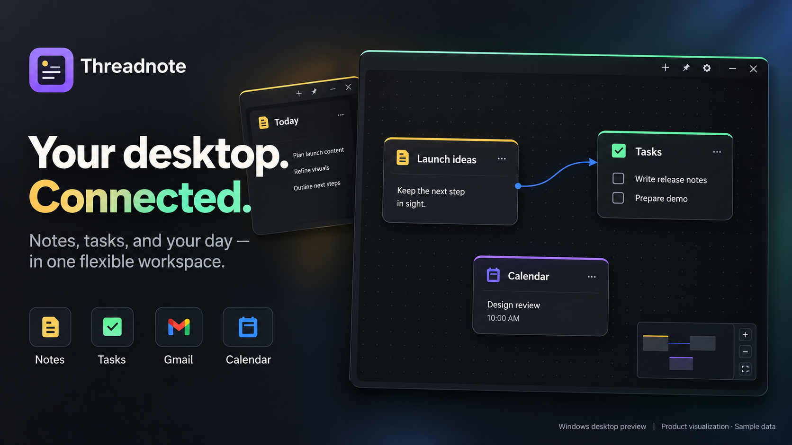
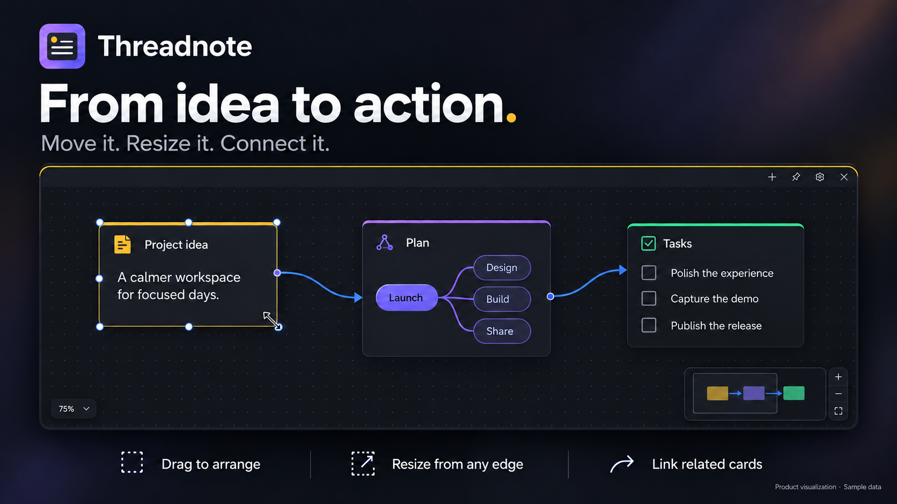
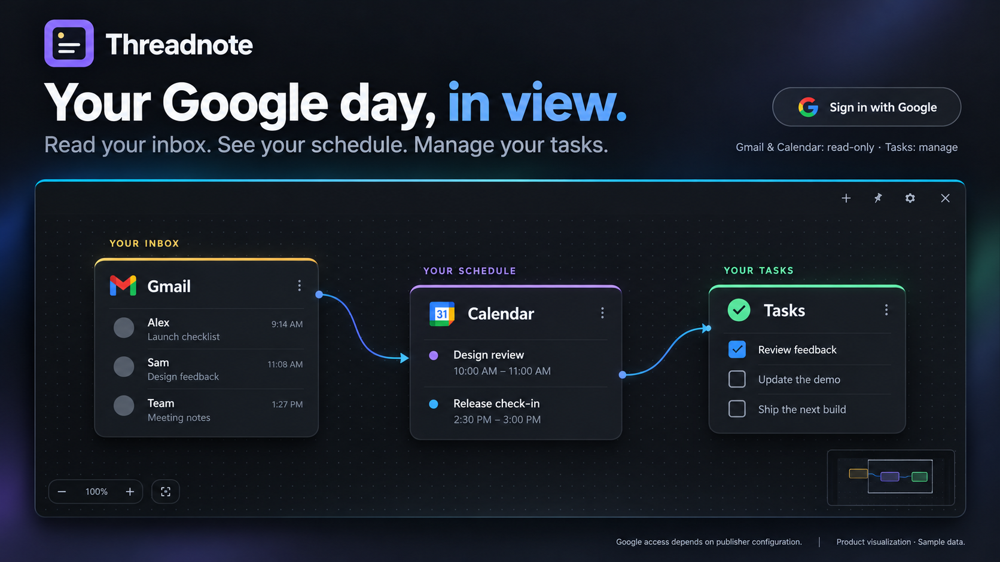
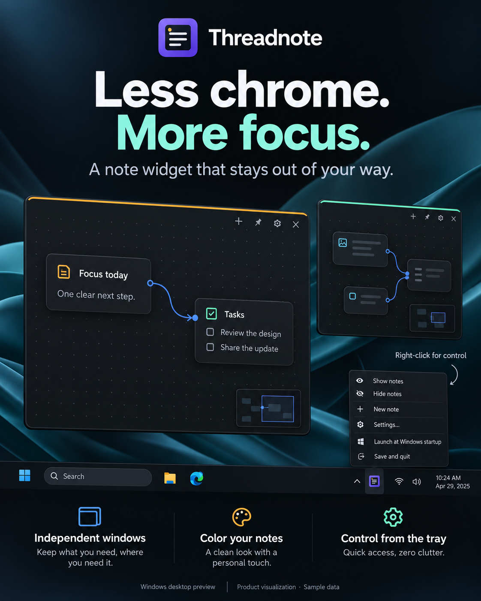

# Threadnote

### Your desktop. Connected.

Threadnote turns your Windows desktop into a flexible, local-first workspace. Capture an idea, organize tasks, keep your schedule in view, and connect related cards—without switching between separate dashboards.

Every window starts as a note. Add the sections you need, arrange them on a pannable, zoomable canvas, and keep independent note windows wherever they work best for you.



> The images in this README are AI-generated promotional visualizations with sample data, not literal screenshots. Layouts are illustrative. Connections represent manually linked cards, not automatic transfers between Google services.

## Download and install

### [⬇ Download for Windows · v0.1.4 preview · x64](https://github.com/MNGH-27/threadnote/releases/download/v0.1.4/Threadnote-0.1.4-Windows-x64-Setup.exe)

**Windows 10 / 11 (64-bit) · Setup installer · approximately 5.4 MiB**

[Release notes](https://github.com/MNGH-27/threadnote/releases/tag/v0.1.4) · [SHA-256 checksums](https://github.com/MNGH-27/threadnote/releases/download/v0.1.4/SHA256SUMS.txt) · [All downloads](https://github.com/MNGH-27/threadnote/releases)

1. Download **Threadnote-0.1.4-Windows-x64-Setup.exe** above—not the source-code ZIP.
2. Run the installer, then open **Threadnote** from the Start menu. No Node.js, Rust, API keys, or developer tools are needed.
3. Hover near the top of a note to reveal its controls. Add sections to that note, or use **+** in the window controls to create another independent note.
4. Open **Settings** if you want to connect Google or change launch-at-startup behavior. Local notes work without signing in.

Before updating, use **Save and quit** from the tray menu. Microsoft WebView2 is required; if it is missing, the installer needs internet access to install the runtime.

> **Preview status:** The installer is unsigned, so Windows may show an unknown-publisher warning. Check the download source before running it; a checksum checks file integrity, not publisher identity. Google access depends on the publisher's API configuration, consent, and applicable verification; this is not a Google-verified unrestricted public release.

The latest published download is **0.1.4**, which fixes tray controls when a live website is open. Version **0.1.5** is being prepared separately and has not yet been published to GitHub. See [0.1.4 changes](docs/changes-0.1.4.md).

## Build a workspace around your ideas

- **Independent note windows.** Each remembers its position, size, accent color, and always-on-top setting.
- **One note, many sections.** Mix text, tasks, mind maps, images, email, calendars, and live websites in the same workspace.
- **Arrange, resize, connect.** Move cards freely, resize windows and cards from all eight directions, expand cards to the workspace, and draw persistent directional links between related content.
- **Navigate without clutter.** Pan and zoom across the canvas, use the minimap for orientation, and reveal minimal controls on hover.
- **Local by default.** Notes save automatically to a local SQLite database. Local notes and tasks work offline.



### What can a note contain?

| Section         | What it does                                                                                                                                           |
| --------------- | ------------------------------------------------------------------------------------------------------------------------------------------------------ |
| Text note       | Capture ideas and add extra text cards anywhere on the canvas.                                                                                         |
| Tasks           | Keep local tasks, or view Google task lists and create or complete Google tasks.                                                                       |
| Mind map        | Organize related ideas inside a mind-map card.                                                                                                         |
| Image           | Keep visual references inside a note; images are stored locally, up to 5 MB each.                                                                      |
| Live website    | Browse an HTTP/HTTPS site in an isolated native child WebView rather than an iframe. Site availability and sign-in restrictions still apply.           |
| Gmail           | Read messages inside the widget or open them in Gmail. HTML-only messages have a safe preview and external-view fallback. No sending or deleting mail. |
| Google Calendar | View your calendars and upcoming events with read-only access.                                                                                         |

## Your Google day, in view

Connect your own Google account from Settings using **Sign in with Google**. Authentication happens in your system browser; Threadnote does not ask for your Google password.

- **Gmail:** read-only email access.
- **Calendar:** read-only calendar and event access.
- **Tasks:** view lists and create or complete tasks.

Google tokens are stored in **Windows Credential Manager**. Google services and live websites need internet access. Local notes are not automatically synchronized to Google or shared with other users.



**Google sign-in is optional and currently subject to publisher configuration and verification.** While the Google project is in testing, only approved test users can connect. Installing the app alone does not grant unrestricted public Google access.

## Keep it on your desktop, not in your way

Threadnote lives in the Windows notification area near the clock; Windows may put its icon under the hidden-icons arrow.

- **Left-click:** show your notes.
- **Right-click:** show or hide notes, create a note, open Settings, toggle Windows startup, or **Save and quit**.
- **Closing a note is not quitting the app.** Use **Save and quit** to save open notes and fully exit.

<p align="center">
  
</p>

## For developers and self-hosted builds

Threadnote uses **Tauri 2, Rust, React, TypeScript, and SQLite**. The application runs locally; Google integration uses OAuth rather than an app-hosted account system.

### Google OAuth setup

1. Create a Google Cloud OAuth credential with application type **Desktop app**.
2. Enable Gmail API, Google Tasks API, and Google Calendar API.
3. Configure the OAuth consent screen and add the intended account as a test user while the app is in testing.
4. Save the downloaded credential as `src-tauri/google-oauth.json`.
5. Rebuild the application.

The credential file is ignored by Git and is embedded at build time. End users only see **Sign in with Google**; each user selects their own account in the system browser through OAuth 2.0 with PKCE. Account switching, cancellation, refresh, partial consent, and revocation are handled by the app. Release builds require valid product credentials.

Public distribution requires the publisher's External audience and applicable Google verification, especially for Gmail's restricted read scope. Code implementation alone does not enable production Google access. See [the product setup and release requirements](docs/google-product-setup.md).

### Build a Windows installer

Use `npm run package:windows` to build the Release NSIS installer, then `npm run release:prepare` to create the handoff folder and checksum. End users only run the installer; they do not need developer tools. See [installer requirements and distribution notes](docs/windows-installer.md).

### Development

See [architecture and module boundaries](docs/architecture.md) and the [release readiness checklist](docs/release-readiness.md). This is a Windows-first application; the current build and tests do not claim Google verification or a signed public release.

```sh
npm install
npm run check
npm run typecheck
npm run tauri dev
```

Use `npm run format` to apply the shared formatting rules. `npm run test:native` runs the Rust security/regression tests. The Windows CI workflow repeats the frontend checks, native tests and clippy. Node 24 is required for the SQLite migration test runner.

Build the local Windows executable with:

```sh
npm run tauri build -- --debug --no-bundle
```
